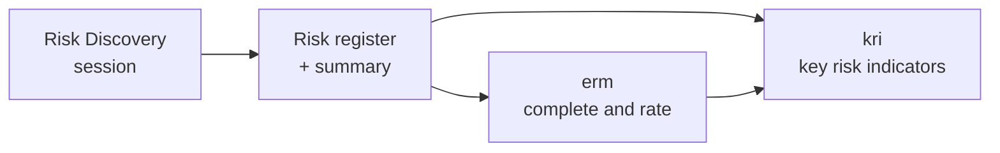

# Risk Discovery Skill - Facilitating a Risk Conversation to Discover Risks

**License**: Apache-2.0\
**Specification**: agentskills.io framework compatible\
**Author**: wai-kwan (https://github.com/wai-kwan)

An AI agent skill that **facilitates a time-boxed risk discovery interview or workshop**. In 30 minutes by default (up to 60), it draws out the risks a person or team genuinely worries about, sharpens them into clear risk statements, ranks the top 3 to 5, and rates them when time allows. Every session ends with two files:

- a **risk register** in the 14 column format of the [erm skill](https://github.com/wai-kwan/enterprise-risk-management), and
- a **session summary** in markdown, ready to consolidate with other sessions.

The agent acts as a neutral facilitator. It asks questions, keeps time and records what it hears, and the participant owns every risk, ranking and rating.

## Why use it
- **Real risks, not generic lists.** Risks come from the participant's own concerns, drawn out with proven techniques (objectives at risk, pre-mortem, worries and near misses, dependencies, coverage sweep), not from a template.
- **Always finishes with a result.** When time runs short, the skill skips straight to ranking, so you leave with a ranked top list even if there is no time to rate.
- **Spreadsheet ready.** The register opens cleanly in Excel, Google Sheets or Numbers and stacks with registers from other sessions.
- **Pause and resume.** Stop at any point and continue later from the saved files.
- **Works with voice.** Short, one-question turns suit voice dictation.

## How a session runs

| Phase | What happens | 30 min plan |
|---|---|---|
| 0 Opening and setup | Explains the flow and agrees the context, scope, time horizon and objective | 3 min |
| 1 Context | What the organisation or project must achieve, depends on, and cannot afford to lose | 4 min |
| 2 Risk elicitation | At least three angles, a running list, then a sweep of strategic, operational and financial gaps | 10 min |
| 3 Sharpen | Merges duplicates and turns the main candidates into specific risks with causes, effects and controls | 6 min |
| 4 Prioritise and rate | Ranks the top 3 to 5 by perceived criticality, then rates likelihood and impact if time allows | 5 min |
| 5 Read back and close | Confirms the context and ranked risks, then writes the two files | 2 min |

Plans for 15, 45 and 60 minute sessions are built in. If context and objective are given up front, the skill shortens the opening and spends the time on finding risks.

### Rating
When there is enough time (about one minute per risk), risks are rated on the erm skill's 1 to 5 scales:

- **Likelihood**: 1 Rare, 2 Unlikely, 3 Possible, 4 Likely, 5 Almost certain
- **Impact**: 1 Insignificant, 2 Low, 3 Moderate, 4 High, 5 Severe

**Risk Score** = Likelihood × Impact, mapped to **CRITICAL** (20 to 25), **HIGH** (10 to 19), **MODERATE** (5 to 9) or **LOW** (1 to 4). Without enough time the session runs in **rank only mode**: the participant's ranking is final and the rating columns are left empty. The skill never guesses ratings.

## Outputs
Files are named with the session date and a short context slug, for example:

```
2026-11-02_company-operations_risk_register.csv
2026-11-02_company-operations_summary.md
```

### Risk register
The exact 14 column layout of the erm skill:

```csv
Risk ID,Category,Risk Title,Description,Causes (Drivers),Effects (Consequences),Likelihood Scale (1-5),Likelihood,Impact Scale (1-5),Impact,Risk Score,Risk Criticality,Preventive Controls,Reductive Controls
```

Only controls the participant mentions are recorded. The register carries no session metadata, so registers from different sessions can be stacked.

### Session summary
Session details and history, the context and objective, the ranked top risks, key discussion points, other risks raised, ranking and rating notes, controls mentioned, open questions, a resume point, and a consolidation table. See [`references/example_session_summary.md`](.github/skills/risk-discovery/references/example_session_summary.md) for a worked example.

## Companion skills
Risk Discovery works on its own and is designed to work with two companion skills:

| Skill | What it adds |
|---|---|
| [erm](https://github.com/wai-kwan/enterprise-risk-management) | Completes a partial register by adding causes, effects, likelihood and impact ratings, and preventive and reductive controls. The mid session hand-off uses its Completion Mode (erm 1.2.0 or later) |
| [kri](https://github.com/wai-kwan/key-risk-indicator) | Builds key risk indicators with Green, Amber and Red thresholds from the register |



Anything erm adds is labelled as an AI proposal for the participant to review, so it is never mistaken for the participant's own assessment.

## Installation
Place the `risk-discovery` skill folder in your workspace or your global agent skills directory. As the [agentskills.io specification](https://agentskills.io/specification) requires, `SKILL.md` sits at the top of the folder and the folder name (`risk-discovery`) matches the skill `name`.

### Workspace setup (local repo)
```
your-project-repository/
└── .github/
    └── skills/
        └── risk-discovery/
            ├── SKILL.md
            └── references/
```

### Claude Code (all projects)
Copy the folder to `~/.claude/skills/risk-discovery/`.

### Direct CLI installation (agentskills CLI)
```bash
npx skills add wai-kwan/risk-discovery
```

### Claude (claude.ai)
Upload the packaged `risk-discovery.skill` file under Settings, Capabilities, Skills, or use the Save skill button on the file card.

### Recommended: install the companion skills
```bash
npx skills add wai-kwan/enterprise-risk-management
npx skills add wai-kwan/key-risk-indicator
```

## Quick start
Ask in plain language, for example:

- `Run a 30 minute risk workshop on our company operations.`
- `Help us discover the top risks of our ERP migration project over the next 9 months.`
- `/risk-discovery 45 minutes, scenario: our main supplier fails during peak season.`
- `What are our top risks? We are a 20 person online retailer planning to expand to Malaysia.`

If you do not give a context and objective, the skill asks for them before looking for risks.

## Pausing, extending, handing off and resuming
- **Time up.** When the planned time is used and the session is not finished, the skill asks once whether to continue for up to 15 more minutes (focused on ranking and wrapping up) or to end and continue later.
- **Pause.** Say "pause" or "stop" at any time. Progress is saved with Status Paused, and the summary records the phase reached and the specific next step.
- **Hand off to erm.** Ask for the erm skill (1.2.0 or later) to complete the register. The skill first saves the participant's own register, then saves erm's completed version as a separate `_erm_` file and marks every AI proposed value, including any cause or effect erm added to the participant's own.
- **Resume.** Start a new session with the saved register and summary. The skill recaps, skips the completed phases, and saves the new part as `<session-id>_part2_...` without overwriting earlier files.

## Group sessions
The agent cannot tell speakers apart, so a group is treated as **one voice**. It does not ask for names, run votes or record who said what. If answers conflict, it names the difference once and asks the group to settle it. If the group cannot, it records the more cautious view and notes in the summary that the rating was escalated.

## Facilitation principles
1. Ask, do not tell: any risk the facilitator suggests is included only if the participant confirms it, and it is labelled as such.
2. Specific beats generic: "cyber" becomes "ransomware locks the order system for several days during the year end peak".
3. Short turns, one question at a time.
4. The participant owns the ranking and ratings.
5. Capture first, judge later.
6. Situations, not blame.
7. One voice for groups.
8. Confidentiality: no names or personal data in the files.

## Skill contents
```
risk-discovery/
├── SKILL.md                                 # The facilitation workflow
└── references/
    ├── question-bank.md                     # Elicitation angles, probing questions, rating anchors
    ├── summary-template.md                  # Structure of the session summary
    ├── pause-and-resume.md                  # Time-up, pause, erm hand-off and resume rules
    ├── example_session_risk_register.csv    # Worked example register (rated)
    └── example_session_summary.md           # Worked example summary (rated)
```

## Limitations
- The agent cannot see a clock. Where it can run commands it records the start time and checks it at each phase change; otherwise it asks you or estimates about one minute per exchange.
- It cannot identify individual speakers (see Group sessions).
- Ratings and thresholds reflect the participant's judgement in the session. Validate them against data and your risk appetite before relying on them.

## License
[Apache-2.0](LICENSE)

## Author
Written by [wai-kwan](https://github.com/wai-kwan). Part of a family of enterprise risk management skills with [erm](https://github.com/wai-kwan/enterprise-risk-management) and [kri](https://github.com/wai-kwan/key-risk-indicator).
